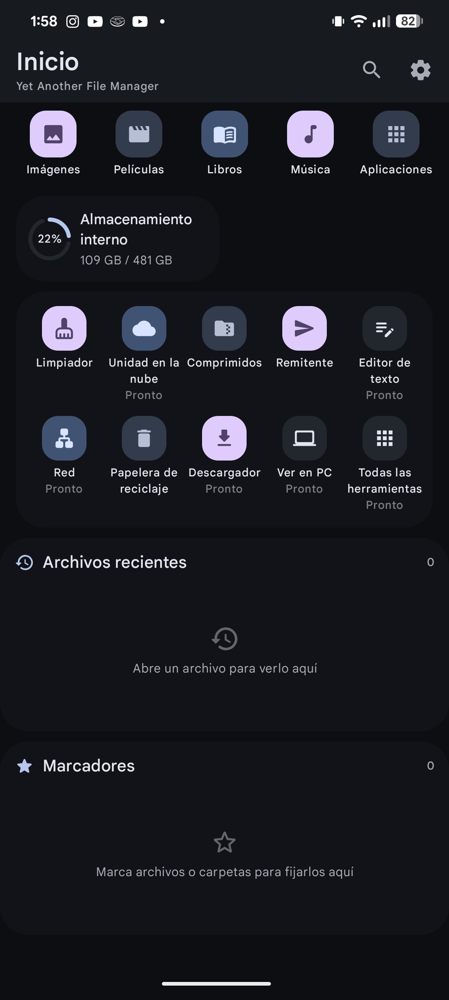
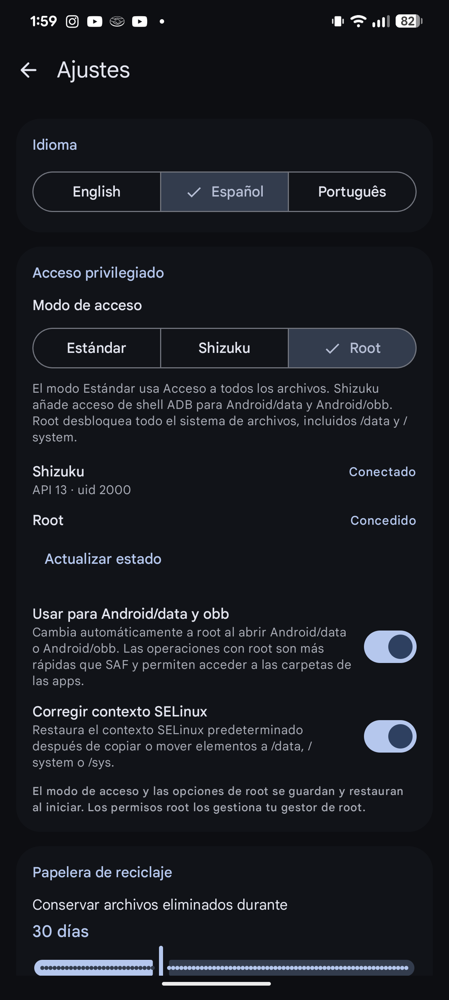
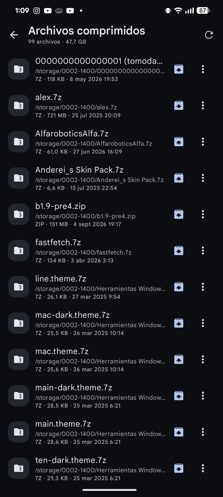
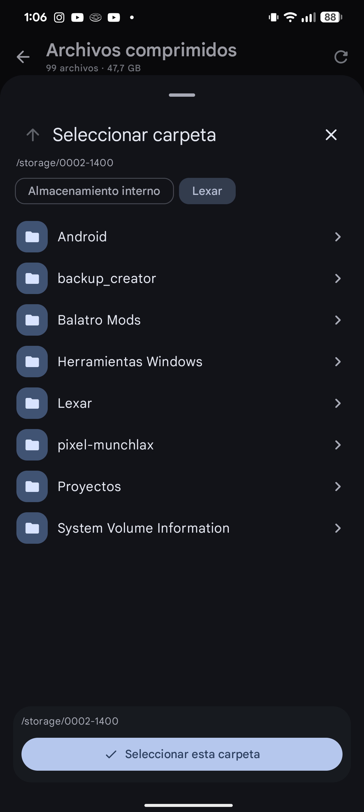
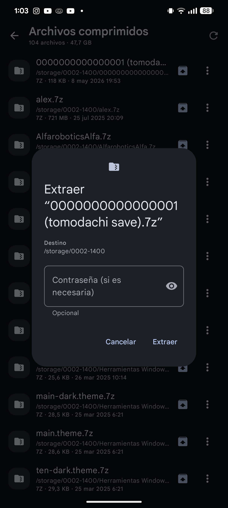
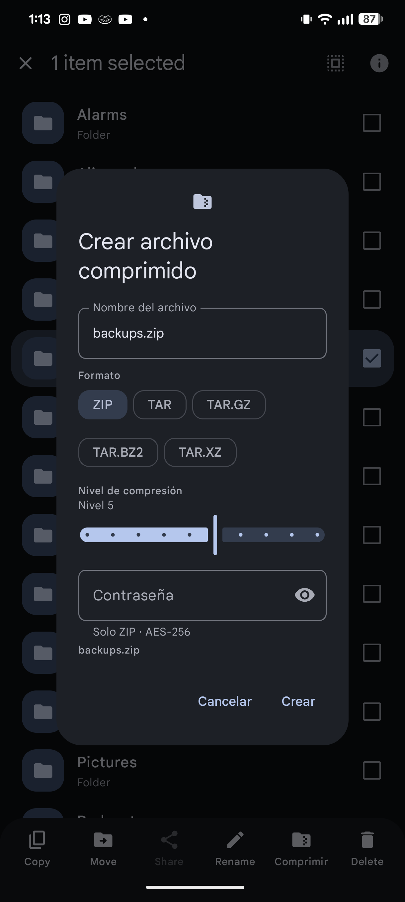
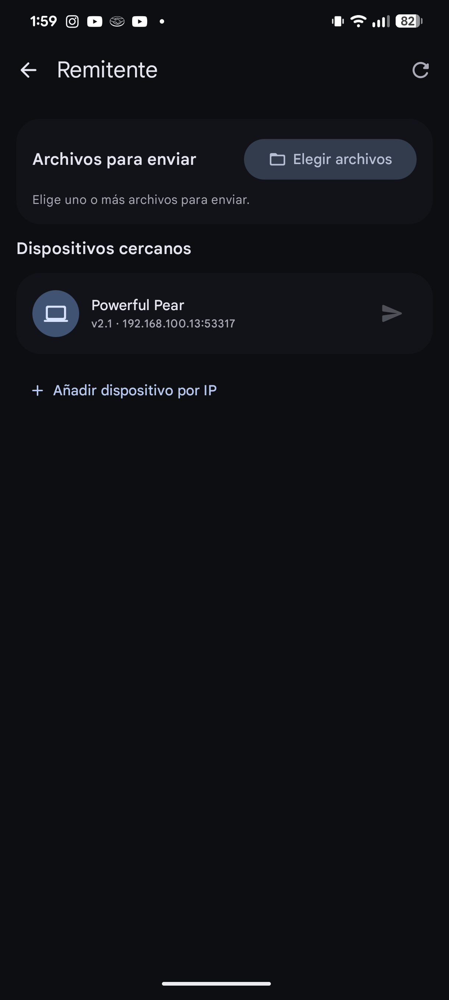
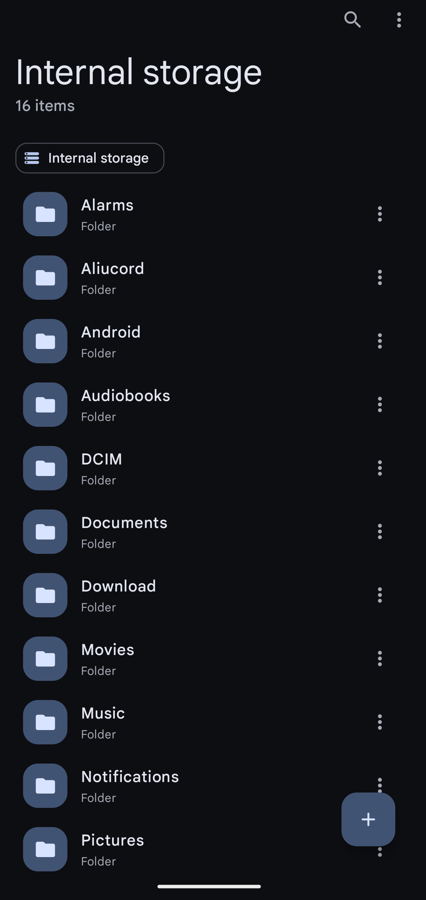
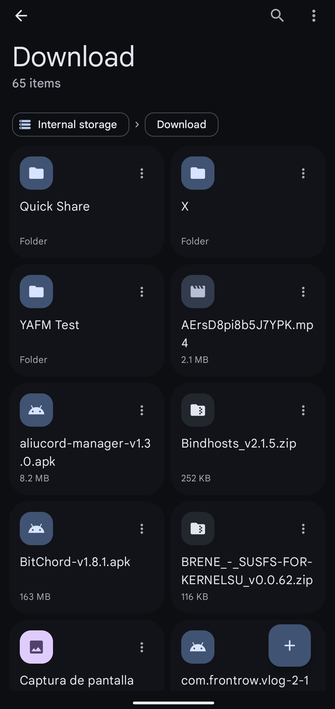

# YAFM — Yet Another File Manager

<p>
  
</p>

A small, functional Android file manager built with **Jetpack Compose** and **Material 3 Expressive**,
with **Shizuku** and **root (Magisk / KernelSU / APatch)** support for protected locations.

The new **Home** screen mirrors ES File Explorer's information architecture — category shortcuts,
storage volumes, a recent-files timeline, bookmarks and a feature grid — rebuilt with Material 3
Expressive surfaces, motion and controls.

<p>
  
  
</p>

<p>
  
  
</p>

<p>
  
  
</p>

<p>
  
</p>

<p>
  
  
</p>

## Features

- ES-style home: category shortcuts, storage volume cards, recent timeline, bookmarks and a
  10-action feature grid
- Internal **and removable storage** volumes (SD card / USB OTG) via `StorageManager`, shown
  two cards per row (tested with a 116 GB Lexar USB drive, including writes)
- Predictive back animations for in-app navigation
- Recent-files timeline recorded when files are opened
- Favorites / bookmarks for files and folders, persisted locally
- Recycle Bin with a configurable retention period (default 30 days), restore, permanent delete,
  empty action and a “Delete Permanently” checkbox in the delete dialog
- Cleaner: empty files/folders, installers, ad files, downloads and the Recycle Bin, with
  category or per-file selection and permanent cleaning (bypasses the Recycle Bin)
- **Compressed Files**: scans internal and removable storage and lists ZIP, 7z, RAR, TAR, GZ,
  BZ2 and XZ archives. Extract any archive to a **reusable modal directory picker** (with
  volume switching and optional password), or use **Extract here**. Archive rows in the explorer
  show a direct extract button in place of the overflow menu (long-press it for the full context
  menu). Create ZIP, TAR, TAR.GZ, TAR.BZ2 and TAR.XZ archives with a compression level, and add
  an AES-256 password to ZIP archives.
- **Sender (LocalSend)**: discovers LocalSend devices using the LocalSend v2 multicast announce
  with an HTTP subnet-scan fallback, and sends selected files over HTTP/HTTPS using
  `/prepare-upload` and `/upload`. Includes optional PIN entry, manual IP discovery, progress,
  cancellation, and a persisted LocalSend fingerprint. This module is send-only; receiving
  uploads is not enabled.
- Language selection: **English, Español, Português** for the home, settings, recycle-bin,
  cleaner and compressed-files surfaces
- Browse internal storage with list and adaptive grid layouts
- App-owned folders show the owning app's launcher icon in the corner
  (package-name folders and UID-owned folders, e.g. Android/data, Android/obb, /data/data)
- Tap-to-open files with the system chooser (FileProvider, no exposed `file://` URIs)
- Breadcrumb navigation, back gesture support, and per-folder item counts
- Multi-select with long press: copy, move, share, rename, delete
- Folder creation, recursive copy/move, name-collision handling (`photo (1).jpg`)
- Sort by name, date, size, or type with ascending/descending direction
- In-folder search, show/hide dotfiles, manual refresh
- Details dialog with type, MIME, location, size, and modified date
- Quick locations sheet: Android/data, Android/obb, Downloads, DCIM, app files, plus
  filesystem root, `/data`, `/system` and `/data/local/tmp` when privileged
- **Three access modes** with persisted settings
  - **Standard** — Android's All files access
  - **Shizuku** — ADB-shell access without root (Android/data, Android/obb); if Shizuku is
    started as root, the whole filesystem is available
  - **Root** — Magisk / KernelSU / APatch `su`, full filesystem including `/`, `/data`, `/system`
  - Settings persist the selected mode, can automatically enter root for **Android/data and
    Android/obb**, and can **restore the default SELinux context** after copying or moving into
    `/data`, `/system` or `/sys`
- Material 3 Expressive UI: `MaterialExpressiveTheme` with expressive motion, flexible large
  app bar, FAB menu, `ButtonGroup` controls, and `LoadingIndicator`

## Privileged access

Android hides `Android/data` and `Android/obb` from ordinary apps. Open the shield icon in the
top bar (or **Access & privileges** in the menu), or use **Settings → Privileged access**.

### Shizuku (no root required)

1. Install [Shizuku](https://shizuku.rikka.app/).
2. Start it — via wireless debugging or via root, depending on your setup.
3. In YAFM, choose **Shizuku** and grant the permission dialog.
4. Use **Locations → Android data / Android obb**, or navigate through `Android/`.

Shizuku runs shell commands with ADB-level access. If you start the Shizuku server *as root*,
YAFM detects `uid 0` and enables root-wide navigation automatically.

### Root (Magisk / KernelSU / APatch)

1. Choose **Root** and approve the root prompt (or grant YAFM in your root manager first).
2. Use **Locations → Root / Data / System / Temp**, or browse up to `/`.

YAFM runs `su -c` for listing and file operations, and stages root-only files into its own
external files directory (with `chmod a+rX`) when they need to be opened or shared.

### Safety

- The selected mode and root options are persisted in Settings; grants from Shizuku and your root manager persist separately.
- Destructive operations (delete / rename / move) are blocked on `/`, `/system`, `/data`,
  `/storage/emulated/0`, `/data/adb` and other top-level system folders.
- Root mode is still powerful: always double-check selections before deleting.
- `MANAGE_EXTERNAL_STORAGE` (declared for Standard mode) requires a Play Store policy
  exception, so this app is intended for sideloading / personal use.

## Build and install

```bash
export JAVA_HOME=/path/to/Android/Studio/jbr   # JDK 17+
./gradlew :app:assembleDebug

adb install -r app/build/outputs/apk/debug/app-debug.apk
# Optional shortcut for local testing, instead of using the settings screen:
adb shell appops set com.anderei.yafm MANAGE_EXTERNAL_STORAGE allow
```

Run the unit tests with:

```bash
./gradlew :app:testDebugUnitTest
```

## Tech stack

| Item | Version |
| --- | --- |
| Android Gradle Plugin | 9.4.1 (built-in Kotlin) |
| Gradle | 9.6.0 |
| Kotlin | 2.2.10 |
| Compose BOM | 2026.09.00 |
| Material 3 | 1.5.0-beta02 (Expressive APIs) |
| Shizuku API | 13.1.5 |
| Archive engine | zip4j 2.11.6 · commons-compress 1.28.0 · junrar 8.1.2 · xz 1.12 |
| min / target SDK | 31 / 36 |

AndroidX, the Shizuku client library and the archive engines above are the runtime dependencies.

## Project layout

```
app/src/main/java/com/anderei/yafm/
├── MainActivity.kt                  Permission gate + entry point
├── data/
│   ├── FileItem.kt                  File model and type detection
│   ├── FileBackend.kt               Backend interface + access modes
│   ├── FileRepository.kt            Standard java.io.File backend
│   ├── ShellBackend.kt              Shizuku/root shell backend, listing, staging
│   ├── PrivilegeManager.kt          Shizuku permission/state and root activation
│   ├── archive/
│   │   ├── ArchiveFormat.kt         Formats, aliases, archive path display
│   │   ├── ArchiveScanner.kt        Coroutine archive discovery over storage volumes
│   │   └── ArchiveRepository.kt     ZIP/TAR/7z/RAR/GZ/BZ2/XZ create + extract engine
│   ├── sender/
│   │   ├── LocalSendModels.kt       Device/file models and JSON mapping
│   │   ├── LocalSendClient.kt       LocalSend HTTP/HTTPS sender + info probe
│   │   ├── LocalSendDiscovery.kt    UDP multicast discovery with safe fallback
│   │   ├── LocalSendServer.kt       Register/info endpoint used for discovery
│   │   └── LocalSendManager.kt      Identity, LAN scan and transfer orchestration
│   └── ...
├── ui/
│   ├── explorer/
│   │   ├── ExplorerState.kt         UI state, sort/layout/clipboard models
│   │   ├── ExplorerUtils.kt         Breadcrumbs and sorting helpers
│   │   ├── FileExplorerViewModel.kt State holder and file operations
│   │   ├── FileExplorerScreen.kt    Scaffold, app bars, list/grid, FAB, sheets
│   │   ├── FileExplorerComponents.kt Rows, cards, dialogs, breadcrumbs
│   │   └── AccessSheet.kt           Standard / Shizuku / Root controls
│   ├── archive/
│   │   ├── CompressedFilesScreen.kt Archive list, row actions, extract/create flows
│   │   ├── CompressedFilesViewModel.kt Scan state and volume roots
│   │   ├── DirectoryPickerSheet.kt  Reusable modal destination picker
│   │   └── ArchiveDialogs.kt        Extract, create and busy dialogs
│   ├── sender/
│   │   ├── SenderScreen.kt          LocalSend peer list, file picker, transfer UI
│   │   └── SenderViewModel.kt       Sender state, permissions and progress
│   ├── permission/PermissionScreen.kt
│   └── theme/Theme.kt               Dynamic color + expressive theme
└── util/
    ├── FileUtils.kt                 MIME, formatting, open/share intents
    └── ShellQuoting.kt              POSIX shell argument escaping
```

## Localization and staged modules

The home, settings, recycle-bin, delete-dialog, compressed-files and Sender surfaces are
localized in English, Spanish and Portuguese. The selected language is applied on top of the system locale in
`MainActivity.attachBaseContext`, so it survives restarts. Legacy explorer screens still use
their original English labels; their string migration is the next localization pass.

The following modules are intentionally **not** marked as done yet — their tiles open a
“Coming soon” screen:
Cloud Drive, Network (Samba), Downloader (yt-dlp), View on PC and All tools.
None of them is faked: the home, the Cleaner, Compressed Files and the LocalSend Sender are
complete, and the remaining modules will be implemented as dedicated passes.

## Implementation notes

- File operations run on `Dispatchers.IO`; results are reported with snackbars.
- Standard mode uses `java.io.File`; privileged modes use a NUL-safe `stat` listing with a
  fast batched path and a fallback for filenames containing newlines.
- Shell arguments are single-quoted with `'\''` escaping, so spaces and apostrophes are safe.
- Moving across filesystems falls back to copy + delete when `mv` fails.
- Copying a folder into itself is rejected.
- Opening a file the app cannot read copies it to `Android/data/<package>/files/staging` and
  serves it through FileProvider.
- Privileged settings live in SharedPreferences (`access_mode`, `use_root_for_app_data`,
  `correct_selinux_context`). Root mode is restored on launch when available; Shizuku is restored
  when its server and permission are available.
- SELinux correction is appended to the root shell copy/move script as a best-effort
  `restorecon -R` for destinations under `/data`, `/system` or `/sys`.
- LocalSend uses the v2 `224.0.0.167:53317` announcement. If that UDP port is occupied (for
  example by the official LocalSend Android app), YAFM falls back to the LocalSend HTTP subnet
  scan and listens on the next free HTTP port (announced as part of its device info).
- LocalSend's HTTPS self-signed certificates are accepted only for LAN transfers; no cloud
  service is involved. `INTERNET` is a runtime permission on some Android 16 builds, so Sender
  shows a direct App-info link if network access must be enabled manually.
- The target SDK is 36 (compiled against 37) so the LAN listener is not blocked by Android 17's
  local-network runtime permission on current builds; `ACCESS_LOCAL_NETWORK` is declared for
  future adoption.
